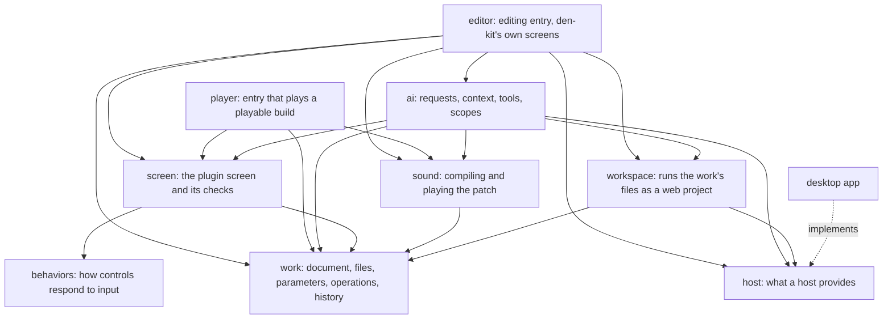
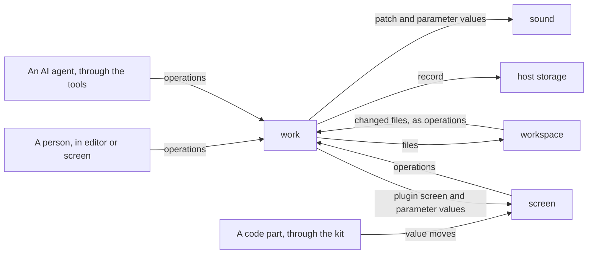

# Architecture

den-kit is a web app in Vue and TypeScript that turns patches of den blocks into audio with
unworklet. It runs in a host, which provides what changes from one host to another. The
rules this structure follows are in [principles.md](principles.md).

## Terms

| Term               | Meaning                                                                                                                                                                                        |
| ------------------ | ---------------------------------------------------------------------------------------------------------------------------------------------------------------------------------------------- |
| Work               | One instrument or effect: a patch that makes the sound and a plugin screen that plays it.                                                                                                      |
| Patch              | den blocks connected by cables.                                                                                                                                                                |
| Parameter          | A value the patch exposes, with a name, range, unit, default and current value. The sound plays with it, and controls and code parts read and move it. A parameter can also point at an asset. |
| Codebox            | A block of DSP written in code inside the patch.                                                                                                                                               |
| Plugin screen      | The screen that plays a work, drawn in the work's own look: its colors, fonts, shapes and pictures.                                                                                            |
| Ready-made control | A control den-kit provides: a knob, slider, button or switch, XY pad, keyboard, scope or meter.                                                                                                |
| Design system      | The look of den-kit's own screens and the default look of the ready-made controls. A work's look overrides those defaults.                                                                     |
| Behaviors          | How a control responds to input and which values and events it sends, without any look.                                                                                                        |
| Code part          | Part of the plugin screen, or all of it, written as web code in the work's files.                                                                                                              |
| Kit                | The package a code part imports to talk to den-kit.                                                                                                                                            |
| Workspace          | Where the work's files run as a web project, with packages, builds, a dev server and commands.                                                                                                 |
| Operation          | One typed change to a work.                                                                                                                                                                    |
| Playable build     | Static files that play a work without the editor or a workspace.                                                                                                                               |
| Host               | The app or environment den-kit runs in.                                                                                                                                                        |
| Agent runtime      | The outside software that runs the AI's conversation, tool calls and sub-agents.                                                                                                               |

## Modules

An arrow means "imports".

`editor` opens a work from the host's storage and starts `sound`, `screen`, `ai` and, when the
host provides a workspace, `workspace`. `player` opens a playable build and starts only
`sound` and `screen`. The entry gives `screen` the host's sandbox and the place code parts
come from, and `editor` saves the record to the host's storage after each change. `work`
imports no other module, and `screen` and `sound` do not import `editor`, so `player` runs
them outside den-kit. No module refers to the desktop app or any other host: they use `host`
([principle 4](principles.md#4-host-and-os-differences-sit-behind-interfaces)). Code in a
work imports none of these modules: a code part imports the kit, which includes `behaviors`,
and any npm package; a codebox uses the unworklet core API and the asset API.

## How a change moves

Every arrow into `work` carries operations
([principle 3](principles.md#3-a-work-is-data-and-only-operations-change-it)). Each
operation records who made it (a person, an agent or a code part) and the state it replaces,
so undo restores exactly that state and each agent's operations are checked against its own
scope. A new parameter value reaches the running audio without recompiling. A change to the
patch is compiled, codebox code included, in a disposable worker, and the result replaces the
running audio with a short crossfade. The agent runtime runs in the host and reaches the work
only through den-kit's tools, which run in the page: each edit is tried on a copy of the work,
checked and compiled, and lands only if it passes. Undo goes back one step at a time, and a
step can hold many operations: a drag is one step, and all edits of one AI request, its
sub-agents' included, are one step. Edits a person makes while a request runs are steps of
their own.

`sound` and `screen` do not import each other, and the parameters are the only values they
share. The entry that starts them also connects two streams that do not go through the
work: notes from the on-screen keyboard to `sound`, and the level, waveform and spectrum of
the sound to `screen`.

## Sound

- `sound` describes, wires, compiles and plays the blocks of the den package. How each block
  sounds is checked in den.
- All DSP, codebox code included, runs as WebAssembly compiled with unworklet.
- Notes from MIDI and the computer keyboard, audio from input devices, and the audio output
  use the standard Web APIs. The host decides which devices den-kit may use, through the
  permissions it gives these APIs. An effect
  processes audio from an input device or from an audio asset.
- The output passes a safety stage, a limiter, a clipper and a mute for broken audio, before
  it reaches the speakers.

## The work

- The document holds the work's name, the patch (blocks, cables and codebox sources), the
  parameters the patch exposes, and the plugin screen (its size, look, controls, decorations
  and where code parts sit).
- The work's files form one tree shaped as a web project: `package.json` and `src/` hold the
  code parts, and `assets/` holds the assets. The record keeps the contents of text files as they
  are and refers to other contents by a hash of the content. Contents never change; replacing
  a file points it at new content.
- `work` defines the versioned work file. It carries the record and the playable build: the
  static files that play the work without the editor or a workspace. Those are `player`,
  the compiled audio processor (JavaScript and WebAssembly), the plugin screen and
  parameters (JSON), the built code parts and the assets. Serving a playable build needs a
  second origin for the code parts.
- `player` never changes a work's record. Values moved while playing are the player's own
  state, which a host such as a DAW can keep.
- Conversations, settings and the person's consent are not part of a work. The host's
  storage keeps them.

## Assets

- An asset can be any file: images, including HDR, 3D models, audio, video, fonts or data.
  den-kit reads only what its own features use: images, fonts and video on the plugin
  screen, and audio in `sound`. Code in a work reads anything else.
- People, the AI and the workspace's tools add files, and each addition is an operation.
  den-kit fetches a URL itself and checks the type and size before the file becomes an
  asset. An asset records where it came from and its license.
- The plugin screen refers to assets by path. A code part gets their URLs from the kit,
  served from the code part's own origin so that ordinary loaders work, and can also import
  them when it is built. den blocks take audio assets through asset parameters. A codebox reads
  them through the asset API: audio as channels of samples, anything else as bytes.
- Assets are loaded fully into memory, up to a size limit.

## Code in a work

- A codebox's source is in the document. `sound` compiles it with the patch into the audio
  processor that runs in the AudioWorklet. Codeboxes can share modules with each other.
- A code part's source is in the work's files. While the person edits, `workspace` builds it
  and serves it from the workspace; otherwise it comes from the playable build. It runs in a
  frame from another origin, with no host API and no network access except to the origins
  the person allowed for that work, and it talks to `screen` only through the kit.
- The kit gives a code part the parameters, to read and to move (while editing, each move is
  an operation; in the player, a move changes only the player's own state),
  the sound's level, waveform and spectrum, its own settings shown in the inspector, the
  work's look, asset URLs and the behaviors of the ready-made controls. The
  [code-part guide](../pod-template/AGENTS.md) describes the kit.
- A work can list the origins its code parts need, each with a reason, and the AI can add to
  the list. The person allows them for that work, and the host keeps that permission in its
  settings, never in the work, so a work never arrives with network access already allowed.
  Outside den-kit, the host that plays the work decides whether to let them through. An
  allowed origin opens connections only: code is never loaded from it.

## AI

- `ai` holds the request flow (sending, progress, stopping), the context sent with a request
  (the selection, sketches and sticky notes, what the person is looking at, pictures of a
  shared screen), the tools (reading the work, applying operations, listening, looking at
  the screen, handling assets, running workspace commands), each agent's scope and one
  conversation per work.
- The agent runtime holds model calls, retries, error handling, sub-agents and conversation
  state ([principle 5](principles.md#5-build-what-makes-music-not-chat-infrastructure)). It
  brings its own tools, such as reading a web page the person pastes or using MCP servers, and
  den-kit does not build them. Bringing something from them into the work goes through asset
  import.
- The provider, the way the person signs in, and the way the tools are offered to the
  runtime can each change without the others: the tools are defined once, and an adapter
  offers them to each runtime, for example through MCP.

## Workspace

- `workspace` keeps a working copy of the work's files in a workspace, installs packages,
  builds and serves code parts, and runs commands for the person and the AI. Changed files
  return to the work as operations made by whoever ran the command; the record stays in the
  work.
- The host decides whether a workspace is available. Without one, everything except editing
  code parts still works, and code parts show from the playable build.

## Interfaces

| Interface      | What the host provides                                                                                                                                               | In the desktop app                                                                                                                 |
| -------------- | -------------------------------------------------------------------------------------------------------------------------------------------------------------------- | ---------------------------------------------------------------------------------------------------------------------------------- |
| AI             | The available providers, each provider's sign-in state, models, capabilities, usage, the notices each provider requires, and the exchange of requests and tool calls | A local bridge to the Codex app-server. Sign in with ChatGPT uses den-kit's own client ID, and the tokens stay in the main process |
| Account        | The person's account, apart from AI sign-in: its sign-in state, what is available to the person, and signing in and out                                              | Signing in through the system browser                                                                                              |
| Storage        | Work records, conversations and settings, synced to the cloud when the person has an account                                                                         | The app's data folder, and a server when the person has an account                                                                 |
| Workspace      | A workspace, or none                                                                                                                                                 | BrowserPod, with a key handed out by a server                                                                                      |
| Sandbox        | A separate origin that serves code parts and the assets they read, and lets through only the origins and devices the person allowed                                  | A second local origin                                                                                                              |
| Screen capture | Pictures of den-kit as the person sees it                                                                                                                            | A capture of the app's own window                                                                                                  |
| Consent        | Asking at first launch, sending analytics only with consent, and keeping the choice when the person makes an account                                                 | A send address set only in distributed builds                                                                                      |
| Lifecycle      | Updates that download in the background and install on quit, and saving before a restart                                                                             | electron-updater                                                                                                                   |

The desktop app in `desktop/` is the host this repository ships, for macOS and Windows.
Other hosts, such as one inside Suara Portal, implement the same interfaces.
