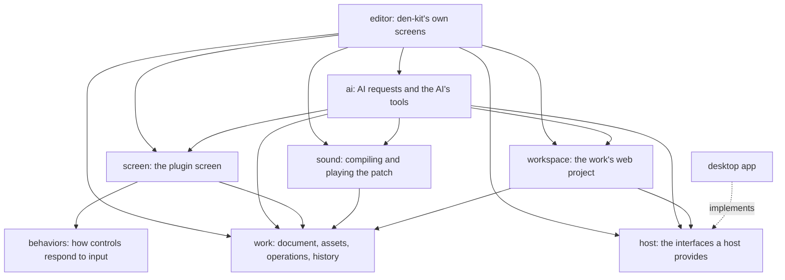
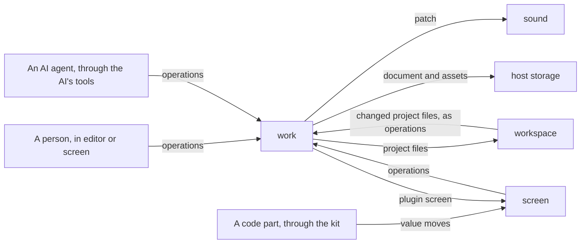

# Architecture

den-kit is a web app in Vue and TypeScript that turns patches of den blocks into audio with
unworklet. It runs in a host, which provides what changes from one host to another. The
rules this structure follows are in [principles.md](principles.md).

## Modules

An arrow means "uses".

`work` uses no other module. `screen` does not use `editor`, so a plugin screen can be shown
without the editing tools. The ready-made controls in `screen` and code parts, through the
kit, respond to input with the same `behaviors`. `screen` draws a plugin screen with the
work's own look, and `editor` draws with den-kit's design tokens. No module refers to the
desktop app or any other host: they use `host`
([principle 4](principles.md#4-host-and-os-differences-sit-behind-interfaces)).

## How a change moves

Every arrow into `work` carries operations
([principle 3](principles.md#3-a-work-is-data-and-only-operations-change-it)). The agent
runtime runs in the host and reaches the work only through den-kit's tools, which run in the
page: each edit is tried on a copy of the work, checked and compiled, and lands only if it
passes. `sound` compiles the patch, codebox code included, in a disposable worker, and swaps
the result into the running audio.

## The work document

The document holds the work's name, the patch (blocks, cables, parts and codebox sources),
the plugin screen (its size, look, controls, decorations and where code parts sit) and the
source files of the work's web project. Assets, such as pictures and fonts, are referred to
by a hash of their content and never change: replacing one adds a new asset. The parts
library is kept outside any work. `work` defines the versioned file format of a work.

## Code in a work

- A codebox's source is in the document. `sound` compiles it into the audio processor that
  runs in the AudioWorklet.
- A code part's source is in the work's web project, which the workspace builds and serves.
  The part is shown in a frame from another origin, which gets no host API and talks to
  `screen` only through the kit. The [code-part guide](../pod-template/AGENTS.md) describes
  the kit.
- Without a workspace, den-kit still edits the patch and the plugin screen; code parts need
  one.

## den

`sound` describes, wires, compiles and plays den's blocks from the den package. How each
block sounds is checked in den.

## Interfaces

| Interface      | What crosses it                                                                                      | In the desktop app                                                      |
| -------------- | ---------------------------------------------------------------------------------------------------- | ----------------------------------------------------------------------- |
| AI             | Requests, the agent's calls to den-kit's tools and their results, progress, sign-in state and models | A local bridge to the Codex app-server, which keeps the ChatGPT sign-in |
| Workspace      | The project's files, commands and their output, and the address of its dev server; or no workspace   | BrowserPod, with a key the host provides                                |
| Storage        | Works, assets, conversations, settings and the parts library                                         | The app's browser storage                                               |
| Screen capture | Pictures of den-kit as the person sees it                                                            | A capture of the app's own window                                       |
| Host settings  | Sign-in, model and update status, and the host's own settings                                        | The app's settings and updater                                          |
