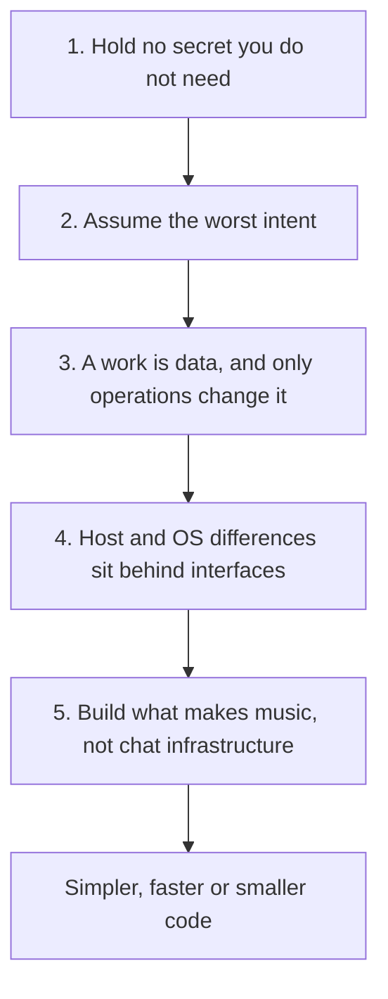

# Design principles

The rules every change to den-kit follows, which rule wins when they conflict, and the ways
they are most often broken. The rules do not name modules: the structure that follows them
is in [architecture.md](architecture.md), and a module's own rules are in the comment at the
top of the module.

## 1. Hold no secret you do not need

**The best defense is not to hold a secret at all. den-kit holds no secret, and no
information about the person, that it can work without.** Anyone who has the app can read
what is in it, so the app ships only values that are safe to publish. What den-kit must use
that costs money or can be abused is handed out by a server, so that its use can be limited,
changed and stopped without a new release. Sign-in tokens stay with the host, and the page
never sees them.

## 2. Assume the worst intent

**Everything people make or bring into den-kit is treated as made to do harm: works, parts,
files, and the code in codebox and code parts, including code an AI wrote.** The harm can be
for the maker's gain, for attention, or to harass people or hurt den-kit.

- Code in a work runs isolated. It cannot reach the host, the person's files, other works or
  any network access the person has not allowed for that work.
- Files people bring in are data. den-kit never runs them; only code in a work reads them,
  inside its isolation.
- A work and its files are checked for type and size before they are used.
- Anything that costs money has a limit on its use and can be stopped.
- Every kind of abuse can be acted on once it is found.

## 3. A work is data, and only operations change it

**A work is data. Every change to it is a typed edit operation, and nothing changes a work
any other way.** An operation is one change that means something to the person making
music, such as adding a block, connecting two blocks, setting a value or placing a control.
People and the AI use the same operations. Code in a codebox or a code part is part of the
work like any ready-made block or control: its source is in the work, and when it moves a
value, that is an operation too.

An operation is checked against the work as it is when the operation is applied. One that
does not fit is refused as a whole and leaves the work as it was. If a person changed
something after the AI read it, the AI's operation on it fails and the AI is told what
changed, so the AI never overwrites a person's edit unseen.

Because every change is an operation, what the AI did can be read on the patch and the
screen and fixed by hand, and undo and conflicts between people and the AI are defined in
operations.

A work's record is its document and its files. What is made from the record, such as
installed packages, build output, compiled audio code and what is drawn on the screen, is
not part of it and can be made again, even when a work file carries a copy of it.

## 4. Host and OS differences sit behind interfaces

**den-kit runs in more than one host and on more than one OS. Whatever changes between them
sits behind an interface, and the code for editing, sound and the plugin screen does not
know which host or OS it runs on.** A feature that only some hosts have is offered through
its interface, not by checking which host is running.

## 5. Build what makes music, not chat infrastructure

**den-kit does not build chat infrastructure: calling models, retrying, handling errors,
running sub-agents and the harness around them. It uses a dedicated agent runtime behind an
interface, and can move to another.** What den-kit builds is what sits outside the chat and
helps make music, such as the audio graph, sticky notes, sketches and sharing the screen
with the AI.

## Priority

When principles conflict, keep the higher one:

A lower item is never a reason to break a higher one. Simpler, faster or smaller code does
not justify breaking any principle.

## Common violations

### A key that costs money ships inside the app

| Aspect       | Detail                                                                                                 |
| ------------ | ------------------------------------------------------------------------------------------------------ |
| Breaks       | 1. Hold no secret you do not need                                                                      |
| Pattern      | A key for a paid service is built into the app, so anyone who has the app can read it and spend on it. |
| Wrong reason | "The key is kept in a CI secret, so it stays secret."                                                  |
| Correction   | Have a server hand the key out, so that it can be limited, changed and stopped at any time.            |

### Code or files from a work get a way out

| Aspect       | Detail                                                                                                                                                                                  |
| ------------ | --------------------------------------------------------------------------------------------------------------------------------------------------------------------------------------- |
| Breaks       | 2. Assume the worst intent                                                                                                                                                              |
| Pattern      | Code a work runs is given a host API, network access the person did not allow, or a way to load more code; or a file a person brought in is put into the page as markup or run as code. |
| Wrong reason | "Only the AI writes this code."                                                                                                                                                         |
| Correction   | Give code in a work only the kit, open network access only to the origins the person allowed for that work, and treat files as data.                                                    |

### A feature changes the work without an operation

| Aspect       | Detail                                                                                                                                                                                                                                        |
| ------------ | --------------------------------------------------------------------------------------------------------------------------------------------------------------------------------------------------------------------------------------------- |
| Breaks       | 3. A work is data, and only operations change it                                                                                                                                                                                              |
| Pattern      | A feature in the editor or on the plugin screen writes to the work directly, or keeps part of the work in its own state or in browser storage. The change cannot be undone, the AI does not see it, and it is lost when the work is exported. |
| Wrong reason | "It is only a small convenience."                                                                                                                                                                                                             |
| Correction   | Express the change as an operation, and add an operation type when no existing one fits.                                                                                                                                                      |

### Editing or AI code checks which host it runs in

| Aspect     | Detail                                                                                    |
| ---------- | ----------------------------------------------------------------------------------------- |
| Breaks     | 4. Host and OS differences sit behind interfaces                                          |
| Pattern    | Code checks whether it runs in the desktop app, and changes what it does or what it says. |
| Correction | Put the difference behind the host's interface, and let each host provide its own part.   |

### den-kit builds what the agent runtime does

| Aspect     | Detail                                                                                                                             |
| ---------- | ---------------------------------------------------------------------------------------------------------------------------------- |
| Breaks     | 5. Build what makes music, not chat infrastructure                                                                                 |
| Pattern    | den-kit retries model calls, starts and coordinates sub-agents itself, or keeps conversation state that the runtime already keeps. |
| Correction | Use the runtime's own feature through the AI interface. When the runtime lacks it, say so instead of building it.                  |
